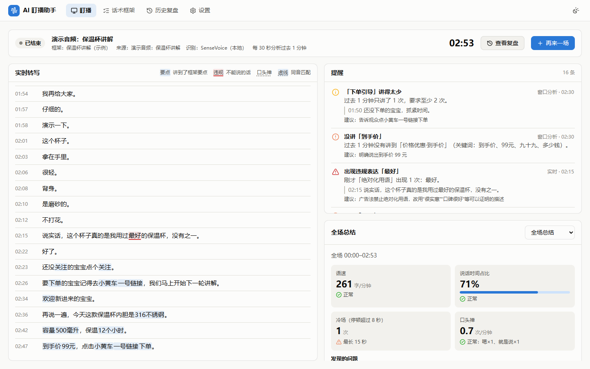
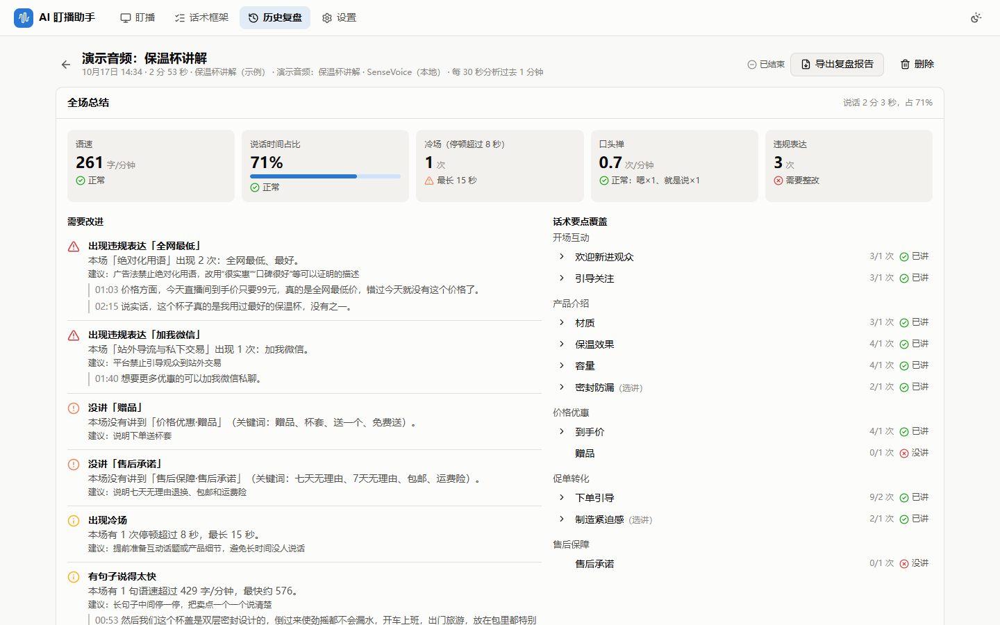

# AI 盯播助手

实时识别主播正在讲的话，按你设定的话术框架，每隔一段时间分析一次最近的讲解，及时提醒语速、节奏和内容上的问题：

- **违规表达**：绝对化用语、站外导流等，一说出口立即提醒，附原话和时间。
- **冷场**：停顿超过设定秒数立即提醒；长时间没有声音信号也会提醒（多半是播放器静音或选错了设备）。
- **漏讲要点**：材质、价格、赠品、售后……每隔 N 秒检查过去 M 秒有没有讲到、讲够次数（默认每 1 分钟分析过去 5 分钟，都可以调）。
- **节奏**：语速偏快或偏慢、单句抢话、说话时间占比偏低、口头禅偏多。
- **大模型审核（可选）**：把转写交给大模型，找关键词规则发现不了的问题，比如说错价格、卖点讲得含糊。

每场盯播自动保存，结束后可以看全场总结、逐条提醒和完整转写，并导出 Markdown 复盘报告。开启录音后，复盘时还能边听边核对，或者用同一段录音重新分析。





> 目前是可运行的早期版本：流程已用合成的演示音频跑通，用真实账号验证过讯飞和百炼接口，也在抖音、快手、B 站、斗鱼、虎牙的真实直播间里试过打开链接、取到声音；识别准确率和提醒是否有用，还要靠[实验 001](experiments/001-真实直播间试盯.md) 这样的实际使用来检验。详见文末“当前限制”。

## 工作方式

```text
声音来源 ──► 语音识别 ──► 逐句检查 ──► 定时窗口分析 ──► 提醒 / 报告 / 历史记录
  系统声音       SenseVoice（本地）   违规词、冷场     语速、占比、要点覆盖     （可选）大模型审核
  麦克风         讯飞实时转写（云端）  即时提醒        每 N 秒分析过去 M 秒
  音频文件
  直播间链接
```

- **语音识别**默认用 SenseVoice，在本机 CPU 上运行，不联网、不收费，首次使用下载约 240 MB 模型。也可以换成讯飞实时转写（云端，按时长计费）。
- **话术框架**由环节和要点组成，每个要点配几个关键词；匹配时会处理数字读法（“500 毫升”能匹配“五百毫升”）和识别出的同音字（“食品级”能匹配“食品及”）。
- 提醒尽量不重复：同一个问题在相邻几次分析里只提醒一次，消失后再出现才再提醒。

## 安装

需要：

- Windows 10/11（主要测试环境）。macOS 理论上可用但还没测试过。
- [uv](https://docs.astral.sh/uv/)（Python 包管理器，会自动安装 Python 3.12）
- Node.js 22.12 或更新版本（构建界面用）

```bash
git clone https://github.com/t1ant1an9cn-sketch/AI-.git
cd AI-
uv sync                                          # 安装 Python 依赖
cd frontend && npm install && npm run build && cd ..   # 构建界面
uv run voicedetect models download               # 下载本地识别模型（约 240 MB），也可以稍后在界面里下载
```

模型默认从 hf-mirror.com 国内镜像下载，失败时自动换 HuggingFace；每个文件都会校验 SHA-256，下载中断后可以续传。无法联网的电脑可以用 `uv run voicedetect models import <文件夹>` 导入别处下载好的模型。

## 使用

```bash
uv run voicedetect            # 打开桌面窗口
uv run voicedetect --browser  # 在浏览器里打开界面
```

第一次使用建议：盯播页选择“演示音频”和“保温杯讲解（示例）”框架，“分析一次过去”选 1 分钟，点“开始盯播”。演示音频是一段约 3 分钟的合成讲解，故意包含违规词、站外导流、冷场和漏讲的要点。

盯真实直播：

- **直播间链接（推荐）**：音频来源选“直播间链接”，粘贴直播间网址（例如 `https://live.douyin.com/…`，平台的分享口令也行）。程序用电脑上的 Edge 或 Chrome 在后台打开直播间，不用开着浏览器，电脑上的其他声音也不会混进来。打开要几秒到二十几秒：网页播放器请求了 flv/m3u8 直播流的（抖音、快手、B 站、斗鱼等），程序直接拉流、随即关掉后台浏览器，断流时自动重连；没有这类地址的（例如虎牙），后台浏览器一直播放，程序从网页里取声音。
- **要登录才能看的直播间**（例如淘宝直播）：粘贴链接后点“登录平台账号”，在弹出的浏览器窗口里登录一次（一般是用手机 App 扫码），能看到直播画面后关掉窗口，再开始盯播。之后打开直播间时，程序会自动带上保存的登录信息；登录过期了再登录一次即可。
- **没有网页版的直播**（例如微信里的视频号）：在电脑上打开直播、放出声音，音频来源选“系统声音 → 只听一个程序”，点刷新后选那个程序（例如微信）。程序只采集它播放的声音，电脑上的其他声音不会混进来。只能在手机上看的直播，可以先用手机厂商的投屏或多屏协同把手机投到电脑上，再选那个投屏程序。“只听一个程序”需要 Windows 11，而且这个程序的声音要从默认播放设备放出来。
- **运营旁听（整个播放设备）**：音频来源选“系统声音 → 整个播放设备”，选中正在播放的扬声器。Windows 10 上只有这一种，直播间链接打不开时也可以用它。电脑上的其他声音会被一起识别，盯播时请关掉其他声音。
- **主播自己用**：音频来源选“麦克风”。
- **复盘录播**：选“音频文件”，支持 mp3、wav、m4a、flac 以及 mp4、flv 等视频文件；不勾选“按实际速度播放”时几秒内就能分析完。

不开界面也能直接分析音频文件或直播间：

```bash
uv run voicedetect analyze 录播.mp4 --framework tpl-thermos-cup --window 60 --interval 20 --report 复盘.md
uv run voicedetect analyze https://live.douyin.com/… --framework tpl-general   # 一直盯到按 Ctrl+C
uv run voicedetect devices    # 列出可以采集的音频设备和正在用声音的程序
```

### 话术框架

在“话术框架”页新建或复制模板，按商品填写：

- **环节和要点**：每个要点填几个关键词，说到任意一个就算讲到一次；可以设置必讲和至少提到几次。
- **违规表达**：分类填写关键词和整改建议。
- **口头禅**和**节奏标准**：语速上下限、冷场秒数、说话占比下限等。
- **给大模型的额外要求**：例如“价格必须是 99 元，赠品是杯套”，开启大模型审核后生效。

框架可以导出成 JSON 分享，也可以导入。

### 设置

- **讯飞实时转写**：在讯飞开放平台的应用里开通“实时语音转写”，把 APPID 和 APIKey 填到“设置 → 语音识别”。
- **录音**：在“设置 → 录音”开启后，实时盯播（系统声音、麦克风、直播间链接）会把声音存到本机，约每小时 115 MB；音频文件本来就在磁盘上，不另存。复盘页顶部会出现播放条，点转写、提醒前面的时间就能跳到录音里对应的位置；“用这段录音重新分析”会沿用原来的话术框架和分析方式，适合改了关键词或换了识别引擎之后对比效果。删除场次时录音一起删除。录音会录下电脑上播放的所有声音，请只在需要时开启。
- **大模型审核**：支持兼容 OpenAI 接口的服务，内置通义千问（阿里云百炼）、DeepSeek、Kimi、智谱、OpenAI 和本机 Ollama 的预设，填好 API Key 后点“测试连接”。开启后，转写内容会发送给所选服务商。百炼上的千问 3 系列默认开启深度思考，一次审核要一分钟左右，程序会自动关闭深度思考（约 13 秒一次）。百炼的免费额度用完后会返回“额度已用完”，需要在百炼控制台充值，或关闭“仅使用免费额度”。

- **直播平台登录**：在“设置 → 直播平台登录”查看登录信息是否已保存，或者清除。登录信息（网站的 Cookie）保存在数据目录的 `logins` 文件夹，Windows 上用系统自带的 DPAPI 加密，换一台电脑或换一个 Windows 用户都用不了。

所有数据保存在本机：Windows 在 `%LOCALAPPDATA%\voicedetect`，macOS 在 `~/Library/Application Support/voicedetect`（可用环境变量 `VOICEDETECT_HOME` 改到别处）。数据库是其中的 `voicedetect.db`，录音在 `recordings` 文件夹，识别模型在 `models` 文件夹，直播平台的登录信息在 `logins` 文件夹。API Key 以明文保存在这个目录的数据库里，界面上只显示遮罩，请不要把数据目录分享给别人。

## 开发

```bash
uv run pytest                 # 后端测试（已下载模型时会多跑两项真实识别测试）
uv run ruff check . && uv run ruff format --check .
cd frontend && npm test && npm run typecheck
```

前端开发时，先启动后端服务，再启动 Vite：

```bash
uv run voicedetect serve --token dev   # 本地服务在 8765 端口
cd frontend && npm run dev             # 打开 http://localhost:5173/#token=dev
```

`scripts/make_demo_audio.py` 用 Windows 自带的中文语音重新生成演示音频。代码结构和设计取舍见 [docs/architecture.md](docs/architecture.md)，实验计划和结果见 [experiments/](experiments/README.md)。

## 当前限制

- **准确率没有在真实直播里验证过**：完整流程只用合成的演示音频跑通过；讯飞只用真实账号测过 30 秒音频。真人直播的口音、背景音乐、连麦都会影响识别效果。
- **关键词匹配不是语义理解**：换个说法讲到了要点，关键词没写到就会被判“没讲”。大模型审核可以补充一部分，但也会误判。
- **系统声音**：“整个播放设备”会混入电脑上的所有声音。“只听一个程序”需要 Windows 11（Windows 10 没有这个系统功能），并且只能采到这个程序送到默认播放设备的声音：在 Windows 的“应用音量和设备首选项”里给它单独指定了别的输出设备时，只能收到静音，程序会提醒“没有收到声音”。只用本机测试程序播放的声音和演示音频测过，还没有用真实的微信视频号试过。macOS 不能直接采集系统声音，需要安装 BlackHole 等虚拟声卡（尚未测试）。
- **直播间链接**需要电脑上装有 Edge 或 Chrome（Windows 10/11 自带 Edge）。只试过抖音、快手、B 站、斗鱼、虎牙各一两个直播间，每次几十秒到一分半。“登录平台账号”只用本机模拟的网站测过，还没有用真实的淘宝账号试过登录后能不能取到声音；网站如果把登录和浏览器的其他信息绑在一起校验，带上 Cookie 也可能不够。视频号这类没有网页版的只能用“系统声音”。从网页取声音时后台浏览器一直在播放，比直接拉流多占一些 CPU 和内存。平台改版可能让某个平台失效，这时改用“系统声音”。
- **网络代理**：拉流时按系统代理设置走（和浏览器一致），只支持 HTTP 代理。
- 同一时间只能盯一场；还没有安装包，需要按上面的步骤从源码运行。
- 演示音频由 Windows 自带的中文语音合成，仅用于体验和测试。
